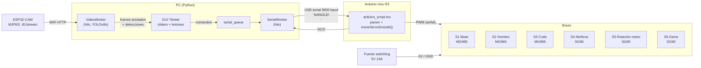
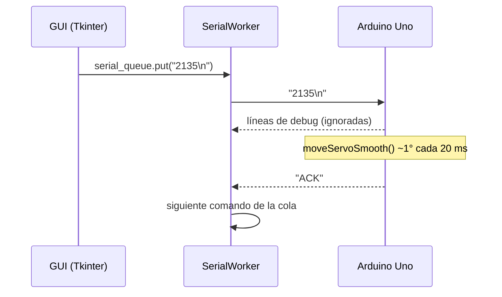

# roboticArm

Brazo robótico de 6 servos (5 GDL + garra) impreso en 3D, controlado desde un PC con una GUI en Python/Tkinter vía USB serial hacia un Arduino Uno R3. Proyecto creado en el ramo de **Electrónica Análoga y Digital**.

**Estado actual:** control manual terminado y funcional. En desarrollo: percepción con cámara (ESP32-CAM + YOLOv8) como primer paso hacia el agarre autónomo (ver [Roadmap](#roadmap)).


---

## Índice

1. [Arquitectura del sistema](#arquitectura-del-sistema)
2. [Hardware](#hardware)
3. [Conexiones y pinout](#conexiones-y-pinout)
4. [Alimentación](#alimentación)
5. [Estructura mecánica](#estructura-mecánica)
6. [Firmware (Arduino)](#firmware-arduino)
7. [Protocolo serial](#protocolo-serial)
8. [Software de control (PC)](#software-de-control-pc)
9. [Módulo de visión (en desarrollo)](#módulo-de-visión-en-desarrollo)
10. [Instalación y uso](#instalación-y-uso)
11. [Cinemática](#cinemática)
12. [Roadmap](#roadmap)
13. [Historial y notas](#historial-y-notas)

---

## Arquitectura del sistema



Capas:

| Capa | Componente | Responsabilidad |
|---|---|---|
| Percepción | ESP32-CAM + YOLOv8n (en PC) | Capturar video y detectar objetos (en desarrollo) |
| Interfaz / planificación | `robot_arm_usb.py` | GUI, cola de comandos, (futuro) cinemática y lógica de agarre |
| Comunicación | USB serial 9600 baud | Comandos de un servo a la vez con confirmación `ACK` |
| Control de bajo nivel | `arduino_script.ino` | Parsear comandos, generar PWM, interpolar movimiento |
| Actuación | 3× MG995 + 3× SG90 | Mover las articulaciones |
| Potencia | Fuente 5V 10A | Alimentar servos (separado de la lógica) |

---

## Hardware

### Lista de materiales (BOM)

| Cant. | Componente | Uso | Notas |
|---|---|---|---|
| 1 | Arduino Uno R3 (ATmega328P) | Controlador de servos | Alimentado por USB desde el PC |
| 3 | Servo MG995 (engranajes metálicos) | Base, hombro, codo | ~9–11 kg·cm a 4.8–6 V |
| 3 | Servo SG90 (micro, plástico) | Muñeca, rotación de mano, garra | ~1.8 kg·cm a 4.8 V |
| 1 | Fuente switching 5V 10A | Potencia de servos | |
| 1 | Placa de prototipado (protoboard) | Distribución de 5V/GND y señales | |
| 1 | ESP32-CAM (AI Thinker, OV2640) | Cámara para visión | En desarrollo |
| — | Estructura impresa en 3D | Esqueleto del brazo | Ver [Estructura mecánica](#estructura-mecánica) |
| — | Cables dupont, tornillería | | |

### Especificaciones de los servos

| Parámetro | MG995 | SG90 |
|---|---|---|
| Voltaje de operación | 4.8 – 7.2 V | 4.8 – 6 V |
| Torque (stall) | ~9.4 kg·cm @ 4.8 V / ~11 kg·cm @ 6 V | ~1.8 kg·cm @ 4.8 V |
| Velocidad | ~0.17 s/60° @ 4.8 V | ~0.1 s/60° @ 4.8 V |
| Corriente en stall (aprox.) | ~1.2 – 1.5 A | ~0.65 A |
| Rango | 0 – 180° | 0 – 180° |
| Cables | Café = GND, Rojo = V+, Naranjo = señal | igual |

> Valores típicos de datasheets genéricos; los clones varían bastante.

---

## Conexiones y pinout

### Asignación de servos

| Servo (ID protocolo) | Articulación | Modelo | Pin Arduino | Posición inicial | Delay por grado |
|---|---|---|---|---|---|
| 1 | Base (giro, yaw) | MG995 | D11 | 90° | 20 ms |
| 2 | Hombro (pitch) | MG995 | D10 | 180° | 20 ms |
| 3 | Codo (pitch) | MG995 | D9 | 140° | 20 ms |
| 4 | Muñeca (pitch) | SG90 | D6 | 90° | 10 ms |
| 5 | Rotación de mano (roll) | SG90 | D5 | 50° | 10 ms |
| 6 | Garra (abrir/cerrar) | SG90 | D3 | 40° | 10 ms |

> La librería `Servo.h` en el Uno usa el Timer1, por lo que `analogWrite()` deja de funcionar en D9 y D10. No afecta a este proyecto porque esos pines se usan como servos.

### Diagrama de conexión

```
                    ┌──────────────────────────┐
   PC ──── USB ────►│      Arduino Uno R3      │
                    │                          │
                    │ D11 ───────────────────────────► Señal S1 (Base, MG995)
                    │ D10 ───────────────────────────► Señal S2 (Hombro, MG995)
                    │ D9  ───────────────────────────► Señal S3 (Codo, MG995)
                    │ D6  ───────────────────────────► Señal S4 (Muñeca, SG90)
                    │ D5  ───────────────────────────► Señal S5 (Rot. mano, SG90)
                    │ D3  ───────────────────────────► Señal S6 (Garra, SG90)
                    │ GND ──────────┐              │
                    └───────────────┼──────────────┘
                                    │  GND común (obligatorio)
  ┌───────────────────┐             │
  │ Fuente 5V 10A     │  GND ───────┴─────────────────► GND (café) de los 6 servos
  │ (switching)       │  +5V ─────────────────────────► V+ (rojo) de los 6 servos
  └───────────────────┘
```

Reglas de cableado:

- **Los servos NO se alimentan desde el pin 5V del Arduino.** El regulador/USB del Uno entrega ~500 mA; un solo MG995 arrancando lo supera y resetea la placa.
- **GND común** entre la fuente y el Arduino. Sin esto la señal PWM no tiene referencia y los servos tiemblan o no responden.
- El Arduino se alimenta por USB (lógica) y la fuente alimenta solo los servos (potencia).

---

## Alimentación

| Consumidor | Corriente típica en movimiento | Pico / stall |
|---|---|---|
| 3× MG995 | ~3 × 0.5 A = 1.5 A | ~3 × 1.4 A ≈ 4.2 A |
| 3× SG90 | ~3 × 0.2 A = 0.6 A | ~3 × 0.65 A ≈ 2 A |
| **Total servos** | **~2 A** | **~6 A** |

La fuente de 5V 10A cubre el peor caso (todos los servos en stall a la vez) con margen. Como el firmware mueve **un servo a la vez**, el consumo real es mucho menor que el pico teórico.

Recomendado: un condensador electrolítico de 470–1000 µF entre +5V y GND cerca de los servos para absorber los picos de arranque.

---

## Estructura mecánica

- Estructura completa **impresa en 3D**.
- Configuración: base giratoria + brazo planar de 3 articulaciones (hombro, codo, muñeca) + rotación de mano + garra. Es decir, **5 GDL + efector final (garra)**.
- Los servos de mayor torque (MG995) están en las articulaciones que cargan más momento (base, hombro, codo); los SG90 en el extremo, donde la carga es baja y el peso importa.

```
            S5 (roll) ── S6 (garra)
             │
        S4 (muñeca, pitch)
             │  L3
        S3 (codo, pitch)
             │  L2
        S2 (hombro, pitch)
             │  L1
        S1 (base, yaw)
       ═══════════════  base fija
```

| Parámetro | Valor |
|---|---|
| Diseño / origen de los STL | _TODO: indicar si es diseño propio o de Thingiverse/Printables (link)_ |
| Material / relleno | _TODO_ |
| L1: base → hombro (altura) | _TODO mm_ |
| L2: hombro → codo | _TODO mm_ |
| L3: codo → muñeca | _TODO mm_ |
| L4: muñeca → punta de la garra | _TODO mm_ |
| Alcance máximo | _TODO mm_ |
| Carga útil aprox. | _TODO g_ |

> Las longitudes de eslabón son necesarias para implementar la cinemática directa e inversa.


---

## Firmware (Arduino)

Archivo: [`arduino_script.ino`](arduino_script.ino)

- Inicializa el serial a **9600 baud** y conecta los 6 servos a sus pines.
- Al arrancar, lleva cada servo a la posición inicial (`90, 180, 140, 90, 50, 40`) y envía `Servo Control Ready`.
- En el `loop()` lee una línea por serial, la parsea, valida y mueve el servo.
- **Movimiento suave** (`moveServoSmooth`): en vez de saltar directamente al ángulo objetivo, avanza de a 1° con un `delay` por grado (20 ms para MG995, 10 ms para SG90). Esto reduce picos de corriente y golpes mecánicos.
  - Ejemplo: mover el hombro 90° tarda 90 × 20 ms ≈ 1.8 s.
- El movimiento es **bloqueante**: mientras un servo se mueve, el Arduino no lee nuevos comandos. Por eso el PC espera el `ACK` antes de mandar el siguiente.

---

## Protocolo serial

| Parámetro | Valor |
|---|---|
| Interfaz | USB (CDC serial del Uno) |
| Baud rate | 9600 8N1 |
| Formato de comando | `<ID><ÁNGULO>\n` en ASCII |
| ID | `1`–`6` (un dígito) |
| Ángulo | `0`–`180` (entero, grados) |

Ejemplos:

| Comando | Efecto |
|---|---|
| `190\n` | Base a 90° |
| `2135\n` | Hombro a 135° |
| `630\n` | Garra a 30° |

Respuesta del Arduino a cada comando:

```
Raw input: 2135
Parsed servo number: 2
Parsed angle: 135
ACK                      ← al terminar el movimiento
```

Si el ID o el ángulo son inválidos responde `Invalid angle received:` (sin `ACK`).



---

## Software de control (PC)

Archivo: [`robot_arm_usb.py`](robot_arm_usb.py)

- **GUI Tkinter**: por cada servo un slider 0–180°, botones `◀`/`▶` (±10°, con autorepetición) y botón `Set`. Botón `Set Starting Position` para volver a la pose inicial.
- **`SerialWorker`** (hilo): consume `serial_queue`, escribe el comando y espera `ACK`. La GUI nunca se bloquea esperando al Arduino.
- **`VideoWorker`** (hilo, opcional): ver sección siguiente.
- Configuración al inicio del archivo:

| Constante | Descripción | Default |
|---|---|---|
| `SERIAL_PORT` | Puerto del Arduino | `COM3` (Windows) / `/dev/tty.usbmodem*` (macOS) |
| `BAUD_RATE` | Debe coincidir con el firmware | `9600` |
| `ESP32_STREAM_URL` | URL del stream MJPEG | `http://192.168.1.100:81/stream` |
| `YOLO_MODEL` | Pesos de YOLO | `yolov8n.pt` |
| `STARTING_POS` | Pose inicial | `[90, 180, 140, 90, 50, 40]` |

Si no están instaladas las dependencias de visión, el programa arranca solo con control manual.

---

## Módulo de visión (en desarrollo)

Archivo: `esp32cam_stream/esp32cam_stream.ino` (no versionado porque contiene credenciales WiFi; ver nota abajo).

- **Placa**: ESP32-CAM AI Thinker con sensor OV2640.
- Se conecta a la red WiFi y sirve un stream **MJPEG** en `http://<IP>:81/stream` (VGA 640×480, calidad JPEG 12).
- En el PC, `VideoWorker` abre el stream con OpenCV, corre **YOLOv8n** (Ultralytics) en cada frame, guarda las detecciones (`label`, `conf`, `box`) y muestra el frame anotado en la GUI.
- Botón `Grab Object`: selecciona la detección de mayor confianza y calcula el centro del bounding box. **Pendiente:** convertir esa posición en ángulos de servo (requiere calibración cámara–robot + cinemática inversa).

Pinout de cámara (AI Thinker estándar): PWDN 32, XCLK 0, SIOD 26, SIOC 27, D7–D0 = 35, 34, 39, 36, 21, 19, 18, 5, VSYNC 25, HREF 23, PCLK 22.

> **Credenciales:** el sketch tiene `ssid`/`password` en el código y está en `.gitignore`. Para versionarlo, mover las credenciales a un `secrets.h` ignorado y commitear un `secrets.example.h`.

---

## Instalación y uso

1. **Firmware**: abrir `arduino_script.ino` en Arduino IDE, seleccionar placa *Arduino Uno* y subir.
2. **Cableado**: conectar según [Conexiones y pinout](#conexiones-y-pinout). Encender la fuente de 5V **antes** de abrir la GUI.
3. **Python** (3.9+):
   ```bash
   pip install pyserial
   ```
   Opcional, para visión:
   ```bash
   pip install opencv-python pillow ultralytics
   ```
4. Ajustar `SERIAL_PORT` (y `ESP32_STREAM_URL` si se usa cámara) en `robot_arm_usb.py`.
5. Ejecutar:
   ```bash
   python robot_arm_usb.py
   ```

---

## Cinemática

### Forward Kinematics (FK)

_Pendiente._ Con la base como rotación en Z y hombro/codo/muñeca como un brazo planar de 3 eslabones, la posición de la muñeca en el plano del brazo es:

```
r = L2·cos(θ2) + L3·cos(θ2 + θ3)
z = L1 + L2·sin(θ2) + L3·sin(θ2 + θ3)
x = r·cos(θ1),  y = r·sin(θ1)
```

donde θi son los ángulos articulares reales (requiere mapear el ángulo del servo 0–180° al ángulo de la articulación, con su offset y sentido).

### Inverse Kinematics (IK)

_Pendiente._ θ1 = atan2(y, x); θ2 y θ3 se obtienen por ley de cosenos en el plano (r, z); θ4 se elige para mantener la orientación deseada de la garra.

---

## Roadmap

- [x] Estructura impresa en 3D y montaje
- [x] Firmware con movimiento suave y protocolo con `ACK`
- [x] GUI Tkinter con control manual
- [x] Hilo serial no bloqueante
- [ ] Medir longitudes de eslabones y offsets de cada servo
- [ ] FK / IK en Python
- [ ] Stream ESP32-CAM + detección YOLOv8 integrada en la GUI
- [ ] Calibración cámara–robot (intrínsecos + extrínsecos, p. ej. con tablero ArUco/ChArUco)
- [ ] Agarre por visión: detección → posición 3D → IK → secuencia de agarre
- [ ] Protocolo de comandos multi-servo (mover todas las articulaciones en un solo mensaje, no bloqueante)
- [ ] Teleoperación + grabación de demostraciones (imágenes + estados articulares)
- [ ] Explorar políticas VLA / imitation learning (p. ej. LeRobot: ACT, SmolVLA) entrenadas con esas demostraciones

---

## Historial y notas

- La idea original era comunicar por **Bluetooth (HC-05)**, pero el módulo no funcionó y por plazos de entrega se cambió a comunicación directa por **USB**.
- El firmware imprime líneas de debug por cada comando; el PC las ignora y solo espera `ACK`.
